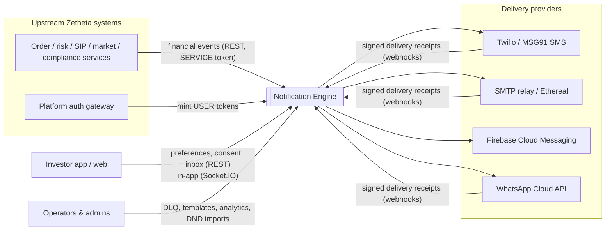
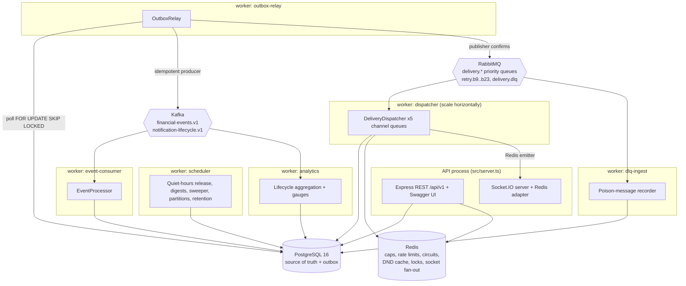
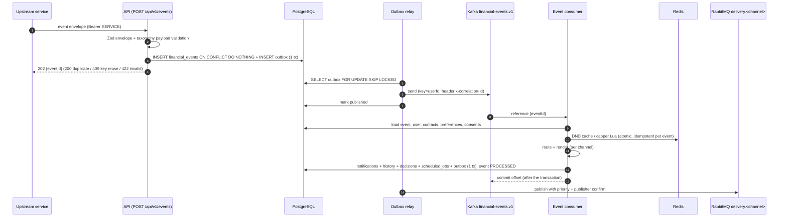
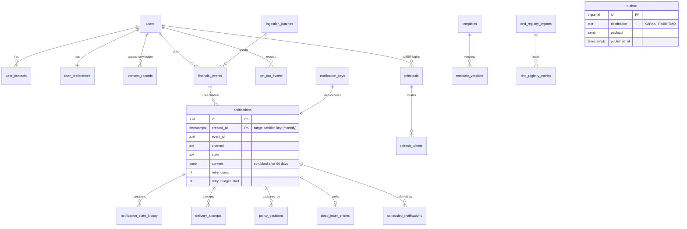

# Architecture — Zetheta BE-6B Notification Engine

This document describes the system as it is implemented in this repository.
Diagrams are Mermaid (rendered by GitHub). Every component named here exists in
`src/`; file references are given so each claim can be checked.

## 1. System context



## 2. Containers (runtime processes)

One codebase, several separately runnable processes (`src/server.ts`,
`src/workers/main.ts`). Every process exposes `/health/live`, `/health/ready`
and Prometheus `/metrics`.



Compose layout (`docker-compose.yml`): `api`, `worker-events`
(outbox-relay, event-consumer, scheduler, dlq-ingest), `worker-dispatch`
(dispatcher + relay, 2 replicas), `worker-analytics`. For local development a
single process can run everything (`RUN_WORKERS=all`).

## 3. Components

| Component              | Responsibility                                                                                                                  | Code                                                                    |
| ---------------------- | ------------------------------------------------------------------------------------------------------------------------------- | ----------------------------------------------------------------------- |
| Event taxonomy         | 25 event types from YAML, compiled to strict Zod schemas; guard rails (no blanket overrides)                                    | `src/modules/taxonomy/taxonomy.ts`, `config/event-taxonomy.yaml`        |
| Ingestion              | Envelope + payload validation, idempotency (`source`,`idempotencyKey`) with payload-hash conflict detection, outbox publication | `src/modules/events/ingestion.ts`                                       |
| Preference resolver    | System → segment → user → regulatory hierarchy with per-value provenance                                                        | `src/modules/preferences/resolver.ts`                                   |
| Compliance             | Consent ledger rules, DND lookup/cache/staleness, typed auditable decisions                                                     | `src/modules/compliance/*`                                              |
| Frequency capper       | Atomic Lua rolling windows (global/channel/category/cooldown), idempotent per event, dry-run                                    | `src/modules/frequency/frequency-capper.ts`                             |
| Quiet hours            | IANA-timezone/DST aware windows, ≥6 h validation, release instants                                                              | `src/modules/scheduling/quiet-hours.ts`                                 |
| Routing engine         | Orders all policy steps per channel, fallbacks for technical unavailability only                                                | `src/modules/routing/routing-engine.ts`                                 |
| Template engine        | Sandboxed Handlebars (known helpers only, AST validation), locale fallback, SMS segmenting, HTML escaping in email layout       | `src/modules/templates/engine.ts`, `templates/*.yaml`                   |
| Event processor        | Kafka handler: enrich → route → render → persist everything in one transaction                                                  | `src/modules/events/processor.ts`                                       |
| Notification lifecycle | The only place states change: transition validation, optimistic concurrency, history, lifecycle outbox                          | `src/modules/notifications/lifecycle.ts`, `src/domain/state-machine.ts` |
| Dispatcher             | Redis lock, crash recovery, policy re-check, provider failover, circuit breaker, provider rate limits, retry/DLQ/fallback       | `src/modules/delivery/dispatcher.ts`                                    |
| Providers              | Twilio, MSG91, SMTP, FCM v1, WhatsApp Cloud, Socket.IO, mock                                                                    | `src/infrastructure/providers/*`                                        |
| Webhooks               | Signature schemes (HMAC, Twilio, Meta, shared secret), de-duplicated forward-only receipts                                      | `src/modules/webhooks/*`, `src/api/routes/webhooks.ts`                  |
| Scheduler              | Durable jobs (`scheduled_notifications`), morning digest folding, sweeper, partitions, retention                                | `src/modules/scheduling/scheduler.ts`                                   |
| Analytics              | Exactly-once hourly aggregates from Kafka lifecycle events; percentile queries                                                  | `src/modules/analytics/service.ts`                                      |
| API layer              | Declarative routes generating OpenAPI 3.0; response-schema validation in non-production                                         | `src/api/http.ts`, `src/app.ts`                                         |

## 4. Event processing sequence



## 5. Delivery and retry sequence

```mermaid
sequenceDiagram
  autonumber
  participant MQ as RabbitMQ delivery.push
  participant D as Dispatcher
  participant RD as Redis
  participant PG as PostgreSQL
  participant P as Provider
  participant RQ as retry.b<k> (TTL)
  MQ->>D: {notificationId, createdAt, retry}
  D->>RD: SET lock:notif:<id> NX PX
  D->>PG: load; ack if not QUEUED/RETRYING or stale retry number
  D->>PG: recover committed SUCCESS attempt / mark PENDING attempts UNKNOWN
  D->>PG: re-check preferences + consent (SUPPRESSED if changed)
  D->>RD: circuit acquire, provider rate limit
  D->>PG: INSERT delivery_attempts (PENDING)
  D->>P: send (timeout)
  alt accepted
    D->>PG: attempt SUCCESS; QUEUED→SENT (+history, lifecycle outbox)
  else transient & retries left
    D->>PG: →RETRYING, retry_count+1, outbox→retry exchange (expiration=delay, header retry-band)
    RQ-->>MQ: dead-letter after TTL back to delivery.push
  else retries exhausted
    D->>PG: →DLQ, dead_letter_entries, outbox→dlx, fallback channel
  else permanent / invalid recipient
    D->>PG: →FAILED/BOUNCED, contact INVALID, fallback channel
  end
  D-->>MQ: ack (only after commit)
  P-->>PG: signed receipt webhook → DELIVERED / READ (forward-only, de-duplicated)
```

Delay: `min(base·2^attempt + jitter(0..1000), max)` per priority profile
(`config/notification-policy.yaml`). RabbitMQ has no native per-message delay,
so retries use **delay bands**: queue `retry.b<k>` holds messages whose TTL is in
`[2^k, 2^(k+1))` ms, bounding head-of-line lateness to the band width while
keeping the exact jittered delay. (Headers-exchange binding keys must not start
with `x-`: RabbitMQ ignores those keys when matching — found and fixed during
verification.)

## 6. Provider failover sequence

```mermaid
sequenceDiagram
  participant D as Dispatcher
  participant CB as Circuit breaker (Redis Lua)
  participant P1 as mock-sms-primary / twilio
  participant P2 as mock-sms-secondary / msg91
  D->>CB: acquire(P1)
  CB-->>D: allowed
  D->>P1: send
  P1-->>D: 503 (TRANSIENT)
  D->>CB: recordFailure(P1) (opens after 5 consecutive failures)
  D->>CB: acquire(P2)
  D->>P2: send
  P2-->>D: accepted
  D->>CB: recordSuccess(P2)
  Note over D: Permanent errors (invalid recipient, rejected content) stop failover:<br/>they would fail on every provider.
  Note over CB: OPEN → after openDurationMs one HALF_OPEN trial → CLOSED on success,<br/>OPEN again on failure; stuck trials are re-admitted after another period.
```

Provider order and enablement come from `provider_configs` (changeable at
runtime via `PATCH /api/v1/ops/providers/:name`). Channel availability (any
enabled provider with a non-open circuit) is also consulted by the router, which
falls back to an alternative channel before queueing when none is healthy.

## 7. Data model (ER)



Other tables: `webhook_receipts` (unique provider event ids), `provider_configs`,
`idempotency_records`, `digest_suggestions`, `analytics_hourly`,
`analytics_processed`, `audit_logs`. Full DDL:
`src/infrastructure/database/migrations/20261011000001_initial_schema.ts`.

**Partitioning.** `notifications` is `PARTITION BY RANGE (created_at)` with
UTC-aligned monthly partitions created by `ensure_notification_partitions()`
(migration + scheduler every 6 h, 1 month back / 3 ahead) and a DEFAULT
partition as a safety net. Because unique constraints on a partitioned table
must include the partition key, logical de-duplication uses the unpartitioned
`notification_keys` table (`evt:<eventId>:<channel>`); child tables reference
notifications without FK constraints (integrity is maintained in the same
transactions). History, attempts and decisions are not partitioned (documented
follow-up).

## 8. Kafka vs RabbitMQ responsibilities

|                 | Kafka                                                                                                                                              | RabbitMQ                                                                                                           |
| --------------- | -------------------------------------------------------------------------------------------------------------------------------------------------- | ------------------------------------------------------------------------------------------------------------------ |
| Carries         | `financial-events.v1` (event **references**, keyed by userId) and `notification-lifecycle.v1` (state transitions, keyed by notificationId)         | Per-channel delivery work items                                                                                    |
| Why             | Durable, replayable log; consumer groups; ordering per user; fan-out to analytics/other consumers                                                  | Per-message priority (`x-max-priority 10`), acks/redelivery per message, TTL-based delayed retries, dead-lettering |
| Guarantees used | Idempotent producer, offsets committed after the DB transaction                                                                                    | Durable queues, persistent messages, publisher confirms, manual acks after commit, prefetch                        |
| Replay          | Reset the consumer group offset (`kafka-consumer-groups --reset-offsets`); processing is idempotent (event status + dedupe keys + idempotent caps) | DLQ manual retry API; sweeper re-enqueues stale QUEUED/RETRYING rows                                               |

Payloads never travel through Kafka: messages carry ids and the consumer reads
the validated payload from PostgreSQL (reduces PII spread, enables retention
scrubbing in one place).

## 9. Delivery guarantees and duplicate handling

- **Ingestion:** exactly-once _record_ per `(source, idempotencyKey)`; a reused
  key with a different payload is rejected (409).
- **Publication:** transactional outbox → at-least-once to Kafka/RabbitMQ; no
  loss between commit and publish (verified: relay outage test).
- **Event processing:** at-least-once delivery, idempotent effects: event status
  check + row lock, `notification_keys`, idempotent cap consumption (Lua replay
  detection) → effectively-once notifications.
- **Delivery:** at-least-once _attempts_. A crash after the provider accepted but
  before commit is recovered from the persisted attempt (no resend); a crash
  _during_ the provider call cannot be disambiguated for providers without
  idempotency keys, so the attempt is marked `UNKNOWN` and retried — **a
  duplicate message to the end user is possible in that window**. True
  end-to-end exactly-once is not claimed.
- **Receipts:** de-duplicated by provider event id; states only move forward.
- **Analytics:** exactly-once aggregation per transition id.

## 10. Failure recovery strategy

| Failure                         | Behaviour                                                                                                    |
| ------------------------------- | ------------------------------------------------------------------------------------------------------------ |
| Kafka/RabbitMQ unavailable      | Rows accumulate in `outbox`; relay retries with backoff; API keeps accepting events                          |
| PostgreSQL unavailable          | Readiness 503; consumers throw → Kafka redelivers / RabbitMQ requeue after 1 s                               |
| Provider outage                 | Failover → circuit opens → retries with backoff ≥ circuit cool-down → DLQ + fallback channel                 |
| Worker crash mid-delivery       | Unacked message redelivered; lock TTL expires; attempts reconciled (SUCCESS recovered, PENDING→UNKNOWN)      |
| Lost message (e.g. queue purge) | Scheduler sweeper re-enqueues stale QUEUED/RETRYING notifications; duplicates are ignored                    |
| Scheduler crash                 | Jobs claimed with `SKIP LOCKED`; stale `PROCESSING` jobs reclaimed by the sweeper                            |
| Poison messages                 | Kafka: parked in DLQ table, offset advances. RabbitMQ: nack → DLX → `delivery.dlq` → `dlq-ingest` records it |

## 11. Architectural decisions and trade-offs

1. **Modular monolith + separately runnable workers** instead of microservices
   (assignment rule 14): one deployable image, independent scaling of
   dispatchers, shared domain code, no distributed transactions.
2. **Knex (not Prisma)**: raw SQL for partitioning, `SKIP LOCKED`, partial
   indexes and `ON CONFLICT`; repositories add the typing.
3. **Outbox everywhere** (events, delivery work, retries, lifecycle events)
   rather than dual writes — simpler failure analysis at the cost of a 50–200 ms
   relay hop.
4. **Notification per (event, channel)**: independent state machines, retries
   and receipts per channel; the event row ties them together.
5. **Preferences re-checked at dispatch**: honours late opt-outs (edge case 3)
   at the cost of one extra read per delivery.
6. **Fallback only for technical unavailability**: never routes around consent,
   DND or a user's preference.
7. **Mandatory overrides bypass preferences, not consent**: conservative
   reading of "regulatory overrides must be explicit"; undeliverable mandatory
   events raise a `MANDATORY_UNDELIVERABLE` decision for operations.
8. **Delay-band retry queues** instead of the RabbitMQ delayed-message plugin
   (not installed by default, non-replicated).
9. **Redis for shared, short-lived state** (caps, circuits, locks, rate limits,
   DND cache, socket fan-out); PostgreSQL remains the source of truth.

## 12. Implementation extensions to the specified lifecycle

`SUPPRESSED` (blocked by consent, a late preference change or user status) and
`DIGESTED` (folded into a digest notification) are additional terminal states.
The complete transition table is in `src/domain/state-machine.ts` and is
unit-tested.
