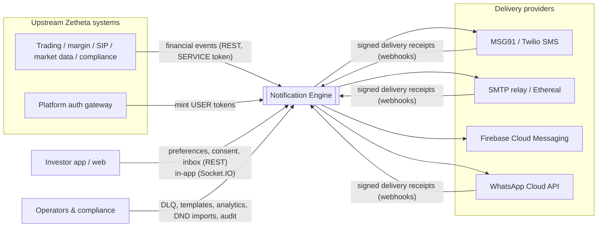
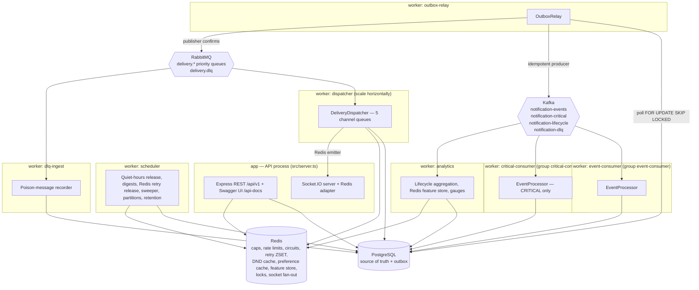
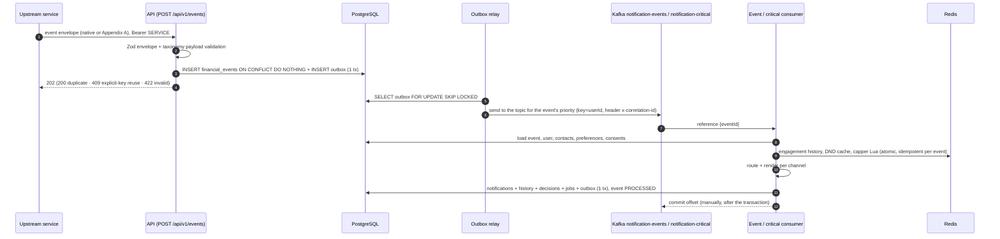
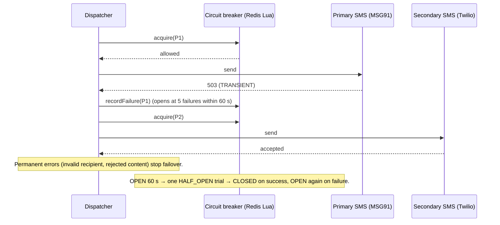
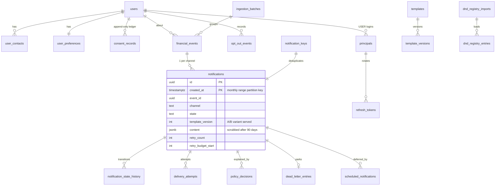

# Architecture — Zetheta BE-6B Notification Engine

This document describes the system as implemented in this repository. Diagrams are
Mermaid (rendered by GitHub). File references point at the PDF §E2 layout so each
claim can be checked. The C4 views, the source-tree map and technology choices are
also in [docs/architecture.md](docs/architecture.md); the three Appendix B flows are
in [docs/sequence-diagrams/](docs/sequence-diagrams/); the schema and its mapping to
PDF §A8 are in [docs/database-schema.md](docs/database-schema.md).

## 1. System context (C4 level 1)



## 2. Containers (C4 level 2 — runtime processes)

One codebase, several separately runnable processes (`src/server.ts`,
`src/workers/main.ts`). Every process exposes `/health/live`, `/health/ready` and
Prometheus `/metrics`; the API also serves `/health` (dependencies + providers).



Compose layout (`docker-compose.yml`, PDF Appendix C services): `postgres` (TLS),
`redis` (AUTH, dangerous commands disabled), `zookeeper` + `kafka` (Confluent 7.5),
`rabbitmq`, `migrate`, `app`, `worker-events` (outbox-relay, event-consumer,
scheduler, dlq-ingest), `worker-critical` (critical-consumer + relay, dedicated
resources), `worker-dispatch` (dispatcher + relay, 2 replicas), `worker-analytics`.
For development one process can run everything (`RUN_WORKERS=all`).

## 3. Components (C4 level 3)

| Component              | Responsibility                                                                                                                          | Code                                                               |
| ---------------------- | --------------------------------------------------------------------------------------------------------------------------------------- | ------------------------------------------------------------------ |
| Event taxonomy         | 25 event types from YAML; compiled strict payload schemas; guard rails (binary classification, no blanket overrides)                    | `src/events/models/taxonomy.ts`, `src/events/validators/*`         |
| Ingestion              | Envelope + payload validation, idempotency (`source`, key) with payload-hash conflicts, time-window storm dedup, routing CRITICAL topic | `src/events/ingestion.ts`                                          |
| Preference resolver    | System → segment → user → regulatory hierarchy with per-value provenance; Redis cache (versioned writes)                                | `src/preferences/*`, `src/database/models/user-repository.ts`      |
| Compliance             | Consent ledger rules, DND lookup/cache/staleness, typed auditable decisions, DND self-audit                                             | `src/compliance/*`                                                 |
| Frequency capper       | Atomic Lua rolling windows (global/channel/category/cooldown), idempotent per event, dry-run                                            | `src/compliance/frequency-cap/frequency-capper.ts`                 |
| Quiet hours            | IANA-timezone/DST aware windows, ≥ 6 h validation, release instants                                                                     | `src/compliance/quiet-hours/quiet-hours.ts`                        |
| Routing engine         | Policy steps per channel; engagement and cost optimisation (§A3.2 P3/P4); fallbacks for technical unavailability only                   | `src/notifications/routing/*`                                      |
| Template engine        | Sandboxed Handlebars, locale fallback, A/B variant selection, SMS ≤ 160 chars, HTML escaping                                            | `src/templates/*`, `templates/*.yaml`                              |
| Event processor        | Kafka handler: enrich → route → render → persist in one transaction; manual-call escalation                                             | `src/events/processor.ts`                                          |
| Notification lifecycle | The only place states change: transition validation, optimistic concurrency, history, lifecycle outbox                                  | `src/notifications/state-machine/*`                                |
| Dispatcher             | Lock, crash recovery, preference/consent/**DND re-check**, failover, circuit breaker, reserved quota, retries/DLQ/fallback              | `src/delivery/dispatcher.ts`                                       |
| Retry scheduler        | Redis sorted set (score = due time), atomic pop, per-tick cap                                                                           | `src/delivery/retry/*`                                             |
| Providers              | MSG91, Twilio, SMTP, FCM v1, WhatsApp Cloud, Socket.IO, mock                                                                            | `src/delivery/providers/*`                                         |
| Webhooks               | Signature schemes (HMAC, Twilio, Meta, shared secret), de-duplicated forward-only receipts                                              | `src/delivery/webhooks/*`, `src/api/routes/webhooks.ts`            |
| DLQ                    | Classification, operator retry/resolve/discard, audit                                                                                   | `src/delivery/dlq/*`                                               |
| Scheduler              | Durable jobs, morning digest folding, sweeper, partitions, retention                                                                    | `src/notifications/engine/scheduler.ts`                            |
| Analytics              | Exactly-once hourly aggregates, PDF report shapes, Redis real-time counters and per-user engagement                                     | `src/analytics/*`                                                  |
| API layer              | Declarative routes → OpenAPI 3.0; PDF Appendix A contract mode; response validation outside production                                  | `src/api/middleware/http.ts`, `src/api/validators/*`, `src/app.ts` |

## 4. Event processing sequence



## 5. Delivery and retry sequence

```mermaid
sequenceDiagram
  autonumber
  participant MQ as RabbitMQ delivery.<channel>
  participant D as Dispatcher
  participant RD as Redis
  participant PG as PostgreSQL
  participant P as Provider
  MQ->>D: {notificationId, createdAt, retry}
  D->>RD: SET lock:notif:<id> NX PX
  D->>PG: load; ack if not QUEUED/RETRYING or stale retry number
  D->>PG: recover committed SUCCESS attempt / mark PENDING attempts UNKNOWN
  D->>PG: re-check status, preferences (fresh read), consent
  D->>RD: DND lookup (SMS) — BLOCK → state DND; ALLOW → decision stored (audit proof)
  D->>RD: circuit acquire; provider rate limit (non-critical stops at 80% of quota)
  D->>PG: INSERT delivery_attempts (PENDING)
  D->>P: send (timeout, correlation id where supported)
  alt accepted
    D->>PG: attempt SUCCESS; QUEUED→SENT (+history, lifecycle outbox)
  else only throttled by our own quota
    D->>RD: ZADD retry schedule (budget not spent)
  else transient & retries left
    D->>PG: →RETRYING, retry_count+1, next_attempt_at
    D->>RD: ZADD retry:schedule score=next_attempt_at
  else retries exhausted
    D->>PG: →DLQ, dead_letter_entries (classified), fallback channel
  else permanent / invalid recipient
    D->>PG: →FAILED/BOUNCED, contact INVALID, fallback channel
  end
  D-->>MQ: ack (only after commit)
  P-->>PG: signed receipt webhook → DELIVERED / READ (forward-only, de-duplicated)
```

Retry delay: `min(base·2^attempt + jitter(0..1000), max)` per priority profile
(`config/notification-policy.yaml`). The scheduler pops due members atomically (Lua
`ZRANGEBYSCORE` + `ZREM`, at most 500 per tick to avoid a thundering herd after an
outage) and enqueues them through the outbox. PostgreSQL `next_attempt_at` is the
durable record: a member lost with Redis is re-enqueued by the stale sweep.

## 6. Provider failover sequence



Provider order and enablement come from `provider_configs` (runtime-changeable via
`PATCH /api/v1/ops/providers/:name`). The router also consults channel availability
and falls back to another channel before queueing when no provider is healthy.

## 7. Data model (ER)



Column-level mapping to the PDF schema, indexes and views: [docs/database-schema.md](docs/database-schema.md).

## 8. Kafka vs RabbitMQ vs Redis responsibilities

|                 | Kafka                                                                                                                                   | RabbitMQ                                                                                    | Redis                                                                         |
| --------------- | --------------------------------------------------------------------------------------------------------------------------------------- | ------------------------------------------------------------------------------------------- | ----------------------------------------------------------------------------- |
| Carries         | `notification-events` and `notification-critical` (event **references**, keyed by userId), `notification-lifecycle`, `notification-dlq` | Per-channel delivery work items                                                             | Retry schedule, caps, rate limits, circuits, caches, counters, locks          |
| Why             | Durable replayable log; consumer groups; ordering per user; CRITICAL isolated on its own topic + group                                  | Per-message priority (`x-max-priority 10`), acks/redelivery, dead-lettering                 | Atomic short-lived shared state (PDF A1.3 "rate limiting, caching, counters") |
| Guarantees used | Idempotent producer, manual offset commit after the DB transaction                                                                      | Durable queues, persistent messages, publisher confirms, manual acks after commit, prefetch | Lua scripts for atomicity; PostgreSQL remains the source of truth             |
| Replay          | Reset consumer-group offsets; processing is idempotent (status + dedupe keys + idempotent caps)                                         | DLQ manual retry API; sweeper re-enqueues stale QUEUED/RETRYING rows                        | —                                                                             |

Payloads never travel through Kafka: messages carry ids and the consumer reads the
validated payload from PostgreSQL (less PII spread, retention scrubbing in one place).

## 9. Delivery guarantees and duplicate handling

- **Ingestion:** exactly-once _record_ per `(source, key)`. An explicit key reused
  with a different payload is rejected (409); a time-windowed derived key
  (price-alert storms) collapses equivalent events and counts them as deduplicated.
- **Publication:** transactional outbox → at-least-once to Kafka/RabbitMQ.
- **Event processing:** at-least-once delivery, idempotent effects (event status +
  row lock, `notification_keys`, idempotent cap consumption) → effectively-once
  notifications.
- **Delivery:** at-least-once _attempts_. A crash after the provider accepted but
  before commit is recovered from the persisted attempt; a crash _during_ the
  provider call is marked `UNKNOWN` and retried — **a duplicate message is possible
  in that window**. End-to-end exactly-once is not claimed.
- **Receipts:** de-duplicated by provider event id; states only move forward.
- **Analytics:** exactly-once aggregation per transition id; Redis counters are best effort.

## 10. Failure recovery strategy

| Failure                         | Behaviour                                                                                                                                                                                                                                                                   |
| ------------------------------- | --------------------------------------------------------------------------------------------------------------------------------------------------------------------------------------------------------------------------------------------------------------------------- |
| Kafka/RabbitMQ unavailable      | Rows accumulate in `outbox`; relay retries with backoff; API keeps accepting events                                                                                                                                                                                         |
| PostgreSQL unavailable          | Readiness 503; consumers throw → Kafka redelivers / RabbitMQ requeue after 1 s                                                                                                                                                                                              |
| Redis unavailable               | **Fail closed** (PDF A12 Q4 / B3.2): cap checks and dispatch locks error, so Kafka redelivers and RabbitMQ requeues — work waits durably until Redis recovers; nothing is sent uncapped. Retry-schedule entries are recovered by the sweeper; engagement routing is skipped |
| Provider outage                 | Failover → circuit opens → retries with backoff → DLQ (classified) + fallback channel                                                                                                                                                                                       |
| Provider quota exhausted        | Non-critical waits for quota without spending retries; CRITICAL keeps a reserved share                                                                                                                                                                                      |
| Worker crash mid-delivery       | Unacked message redelivered; lock TTL expires; attempts reconciled (SUCCESS recovered, PENDING→UNKNOWN)                                                                                                                                                                     |
| Lost message (e.g. queue purge) | Scheduler sweeper re-enqueues stale QUEUED/RETRYING notifications; duplicates ignored                                                                                                                                                                                       |
| Poison messages                 | Kafka: DLQ table + `notification-dlq`, offset advances. RabbitMQ: nack → DLX → `delivery.dlq` → `dlq-ingest`                                                                                                                                                                |
| Mandatory channel unreachable   | `MANDATORY_UNDELIVERABLE` decision + DLQ `ESCALATE_MANUAL_CALL` entry (manual call queue)                                                                                                                                                                                   |

## 11. Architectural decisions and trade-offs

1. **Modular monolith + separately runnable workers**: one image, independent
   scaling of dispatchers and the critical consumer, no distributed transactions.
2. **Knex (not Prisma)**: raw SQL for partitioning, `SKIP LOCKED`, partial indexes,
   `ON CONFLICT`; repositories add typing.
3. **Outbox everywhere** rather than dual writes, at the cost of a relay hop.
4. **Notification per (event, channel)**: independent state machines and receipts.
5. **Preferences, consent and DND re-checked at dispatch**: honours late opt-outs
   and DND registrations (TRAI: check at the last moment).
6. **Fallback only for technical unavailability**: never routes around consent,
   DND or a preference.
7. **Mandatory overrides bypass preferences and caps, not consent.**
8. **CRITICAL isolation end to end**: own Kafka topic + consumer group + worker,
   RabbitMQ priority 10, a reserved share of provider quota. Measured: margin-call
   push p99 139 ms while bulk HIGH traffic queued for minutes (performance doc).
9. **Retry scheduling in Redis (ZSET)** as the PDF specifies, with PostgreSQL as the
   durable record — replaces the earlier RabbitMQ delay-band queues.
10. **PDF Appendix A contracts beside the native API** (contract mode chosen by the
    request shape) instead of a breaking rename.

## 12. Implementation extensions to the specified lifecycle

`SUPPRESSED` (blocked by consent, a late preference change or user status) and
`DIGESTED` (folded into a digest) are additional terminal states; QUEUED/RETRYING →
`DND` exists for the dispatch-time DND check. The transition table is in
`src/notifications/state-machine/state-machine.ts` and is unit-tested.
