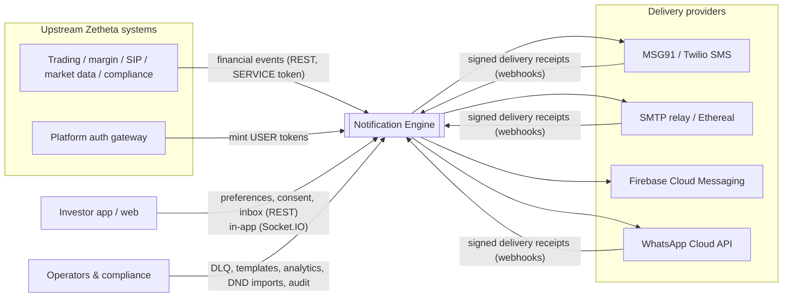
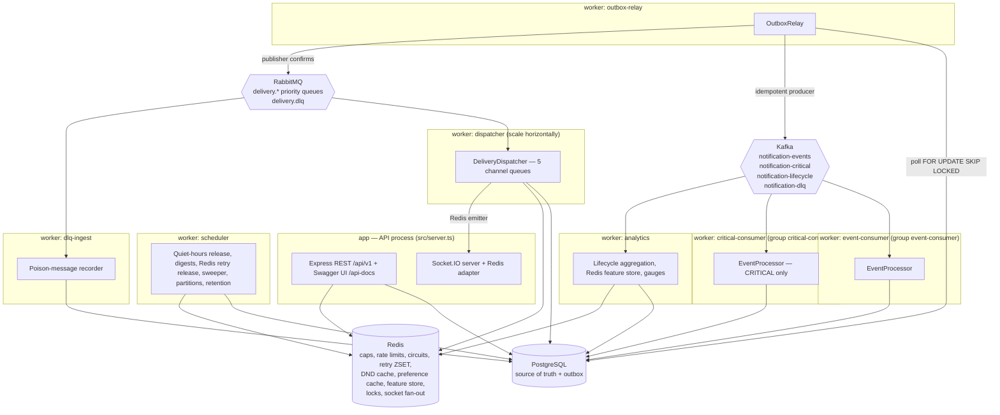

# Architecture (C4) — Zetheta BE-6B Notification Engine

PDF Day 1 asks for `docs/architecture.md` with system context, container and
component diagrams (C4), technology choices with justification and the event
pipeline design. The C4 views below are the same as sections 1–3 of the root
[ARCHITECTURE.md](../ARCHITECTURE.md), which also holds the sequence diagrams, ER
diagram, delivery guarantees, failure handling and decisions. Appendix B flows:
[sequence-diagrams/](sequence-diagrams/). Schema: [database-schema.md](database-schema.md).

## 1. System context (C4 level 1)

## 2. Containers (C4 level 2 — runtime processes)

One codebase, several separately runnable processes (`src/server.ts`,
`src/workers/main.ts`). Every process exposes `/health/live`, `/health/ready` and
Prometheus `/metrics`; the API also serves `/health` (dependencies + providers).

Compose layout (`docker-compose.yml`, PDF Appendix C services): `postgres` (TLS),
`redis` (AUTH, dangerous commands disabled), `zookeeper` + `kafka` (Confluent 7.5),
`rabbitmq`, `migrate`, `app`, `worker-events` (outbox-relay, event-consumer,
scheduler, dlq-ingest), `worker-critical` (critical-consumer + relay, dedicated
resources), `worker-dispatch` (dispatcher + relay, 2 replicas), `worker-analytics`.
For development one process can run everything (`RUN_WORKERS=all`).

## 3. Components (C4 level 3)

| Component              | Responsibility                                                                                                                          | Code                                                               |
| ---------------------- | --------------------------------------------------------------------------------------------------------------------------------------- | ------------------------------------------------------------------ |
| Event taxonomy         | 25 event types from YAML; compiled strict payload schemas; guard rails (binary classification, no blanket overrides)                    | `src/events/models/taxonomy.ts`, `src/events/validators/*`         |
| Ingestion              | Envelope + payload validation, idempotency (`source`, key) with payload-hash conflicts, time-window storm dedup, routing CRITICAL topic | `src/events/ingestion.ts`                                          |
| Preference resolver    | System → segment → user → regulatory hierarchy with per-value provenance; Redis cache (versioned writes)                                | `src/preferences/*`, `src/database/models/user-repository.ts`      |
| Compliance             | Consent ledger rules, DND lookup/cache/staleness, typed auditable decisions, DND self-audit                                             | `src/compliance/*`                                                 |
| Frequency capper       | Atomic Lua rolling windows (global/channel/category/cooldown), idempotent per event, dry-run                                            | `src/compliance/frequency-cap/frequency-capper.ts`                 |
| Quiet hours            | IANA-timezone/DST aware windows, ≥ 6 h validation, release instants                                                                     | `src/compliance/quiet-hours/quiet-hours.ts`                        |
| Routing engine         | Policy steps per channel; engagement and cost optimisation (§A3.2 P3/P4); fallbacks for technical unavailability only                   | `src/notifications/routing/*`                                      |
| Template engine        | Sandboxed Handlebars, locale fallback, A/B variant selection, SMS ≤ 160 chars, HTML escaping                                            | `src/templates/*`, `templates/*.yaml`                              |
| Event processor        | Kafka handler: enrich → route → render → persist in one transaction; manual-call escalation                                             | `src/events/processor.ts`                                          |
| Notification lifecycle | The only place states change: transition validation, optimistic concurrency, history, lifecycle outbox                                  | `src/notifications/state-machine/*`                                |
| Dispatcher             | Lock, crash recovery, preference/consent/**DND re-check**, failover, circuit breaker, reserved quota, retries/DLQ/fallback              | `src/delivery/dispatcher.ts`                                       |
| Retry scheduler        | Redis sorted set (score = due time), atomic pop, per-tick cap                                                                           | `src/delivery/retry/*`                                             |
| Providers              | MSG91, Twilio, SMTP, FCM v1, WhatsApp Cloud, Socket.IO, mock                                                                            | `src/delivery/providers/*`                                         |
| Webhooks               | Signature schemes (HMAC, Twilio, Meta, shared secret), de-duplicated forward-only receipts                                              | `src/delivery/webhooks/*`, `src/api/routes/webhooks.ts`            |
| DLQ                    | Classification, operator retry/resolve/discard, audit                                                                                   | `src/delivery/dlq/*`                                               |
| Scheduler              | Durable jobs, morning digest folding, sweeper, partitions, retention                                                                    | `src/notifications/engine/scheduler.ts`                            |
| Analytics              | Exactly-once hourly aggregates, PDF report shapes, Redis real-time counters and per-user engagement                                     | `src/analytics/*`                                                  |
| API layer              | Declarative routes → OpenAPI 3.0; PDF Appendix A contract mode; response validation outside production                                  | `src/api/middleware/http.ts`, `src/api/validators/*`, `src/app.ts` |

## 4. Source layout (PDF §E2)

The repository follows the §E2 tree; every listed path exists and contains the
code it names. Two additional directories hold code with no §E2 home.

| §E2 path                                | Contents                                                                                 |
| --------------------------------------- | ---------------------------------------------------------------------------------------- |
| `src/config/`                           | Environment schema (`env.ts`), policy loader (`policy.ts`)                               |
| `src/events/models/`                    | Taxonomy model and event factory (sample payloads)                                       |
| `src/events/validators/`                | Payload field compiler (Zod), ingestion envelope and Kafka message schemas               |
| `src/events/taxonomy.yaml`              | Copy of `config/event-taxonomy.yaml` (kept identical by a unit test)                     |
| `src/events/`                           | Ingestion service and Kafka event processor                                              |
| `src/notifications/engine/`             | Notification factory, service, scheduler, user-context enrichment                        |
| `src/notifications/routing/`            | Routing engine (§A3.2 priorities 1–4) and spend budgets                                  |
| `src/notifications/state-machine/`      | Transition table and the lifecycle (history + lifecycle events)                          |
| `src/delivery/providers/`               | `DeliveryProvider` interface, registry, MSG91/Twilio/SMTP/FCM/WhatsApp/Socket.IO/mock    |
| `src/delivery/circuit-breaker/`         | Pure reducer + Redis Lua store                                                           |
| `src/delivery/retry/`                   | Backoff formula and Redis sorted-set retry scheduler                                     |
| `src/delivery/` (+ `dlq/`, `webhooks/`) | Dispatcher, DLQ repository/service, receipt verification and processing                  |
| `src/templates/engine/`                 | Handlebars engine, versioned template repository (A/B), SMS length rules                 |
| `src/templates/definitions/`            | Loader for the template definitions in `templates/*.yaml`                                |
| `src/templates/locales/`                | Supported locales and their formatting tags                                              |
| `src/preferences/`                      | Preference schema and hierarchy resolver                                                 |
| `src/compliance/dnd/`                   | DND registry lookup, cache, staleness rules                                              |
| `src/compliance/frequency-cap/`         | Redis Lua frequency capper (+ in-memory reference implementation)                        |
| `src/compliance/quiet-hours/`           | Quiet-hours windows and release instants                                                 |
| `src/compliance/`                       | Consent rules, typed policy decisions, decision and consent repositories                 |
| `src/analytics/`                        | Analytics service (PostgreSQL aggregates, PDF report shapes) and Redis feature store     |
| `src/api/routes/`                       | Route modules                                                                            |
| `src/api/middleware/`                   | Route builder (auth, RBAC, rate limiting, OpenAPI), auth service, permissions            |
| `src/api/validators/`                   | Shared request/response schemas, PDF Appendix A contract schemas                         |
| `src/database/migrations/`              | Knex migrations                                                                          |
| `src/database/seeds/`                   | Seed script and deterministic synthetic data                                             |
| `src/database/models/`                  | Row types and repositories (users, contacts, notifications, audit)                       |
| `src/utils/`                            | Clock, context, crypto, errors, logger, metrics, PII masking, rate limiter, shared types |
| `tests/{unit,integration,e2e,load}/`    | Jest suites; k6 scripts in `tests/load/`                                                 |
| `templates/`                            | Handlebars template text per locale                                                      |
| _(extra)_ `src/infrastructure/`         | Kafka, RabbitMQ, Redis and outbox adapters                                               |
| _(extra)_ `src/workers/`                | Worker entry point and worker wiring                                                     |

## 5. Technology choices

| Choice                                   | Why                                                                                                                             |
| ---------------------------------------- | ------------------------------------------------------------------------------------------------------------------------------- |
| Node.js 20 + TypeScript (strict)         | Required stack (§E1); strict types catch contract drift across modules                                                          |
| Express 5 + Zod + zod-to-openapi         | One route definition yields validation and the OpenAPI document (Fastify was "preferred", Express is allowed)                   |
| PostgreSQL + Knex                        | Partitioning, partial/BRIN/GIN indexes, `SKIP LOCKED` and `ON CONFLICT` need raw SQL; Knex migrations are required (Day 2)      |
| Kafka for ingestion and lifecycle events | Durable, replayable log with consumer groups and per-user ordering (§A1.3); separate CRITICAL topic prevents priority inversion |
| RabbitMQ for delivery work               | Per-message priority, acks, dead-lettering (§A1.3 "delivery routing, priority queues, DLQ")                                     |
| Redis for shared short-lived state       | Atomic Lua for caps, rate limits, circuits and the retry ZSET; caches and real-time counters (§A1.3)                            |
| Transactional outbox                     | No message loss between a database commit and a broker publish                                                                  |
| Handlebars (sandboxed)                   | Required engine (§E1); known-helper allow-list blocks template injection                                                        |
| pino + prom-client                       | Structured JSON logs and Prometheus metrics (§A11)                                                                              |
| Jest + Supertest + k6                    | Required test stack (§E1)                                                                                                       |

## 6. Event processing pipeline (design)

1. **Ingest** (`POST /api/v1/events`): validate, deduplicate, store event + outbox row in one transaction.
2. **Publish**: the relay sends a reference to `notification-events`, or `notification-critical` for CRITICAL events.
3. **Enrich and route** (event / critical consumer): user context, preferences, consent, engagement → channel plan
   with regulatory overrides, cost rules, quiet hours and caps; render templates; persist notifications, decisions
   and delivery work in one transaction.
4. **Deliver** (dispatcher per channel queue): re-check preferences, consent and DND, send via provider with
   failover and circuit breaking, schedule retries in Redis, dead-letter when exhausted.
5. **Track**: signed receipts move notifications to DELIVERED/READ; lifecycle events feed analytics.
